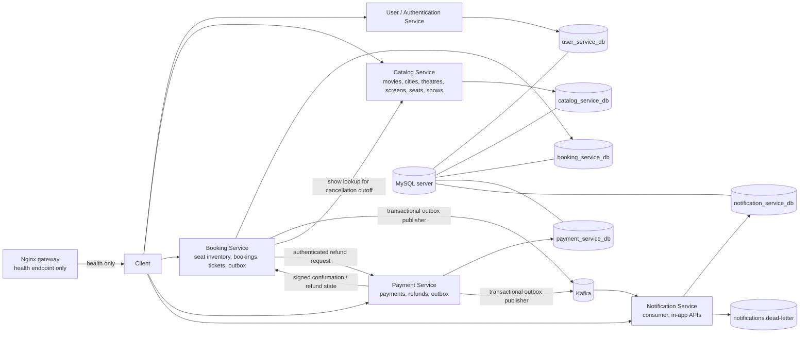

# Movie Ticket Booking Microservices

A Laravel-based movie booking platform split into independently configured
services. Booking and payment state changes use local database transactions;
booking/payment domain events are written to transactional outboxes and
published to Kafka. Notification Service consumes those events and stores
in-app notifications.

## Current capabilities

- JWT register/login/profile/logout in User Service.
- Movie, city, theatre, screen, seat, and show CRUD in Catalog Service.
- 1–10 seat locks with an eight-minute expiry in Booking Service.
- Payment intents, signed success/failure callbacks, refund requests, and
  signed refund callbacks in Payment Service.
- Signed payment-to-booking confirmation; expired locks are released and
  rejected payments create an idempotent pending refund request.
- Database ticket generation during confirmation; ticket number uses the
  database-generated ticket row ID.
- Owner-scoped cancellation before the show starts; cancellation requests a
  full remaining refund and emits `booking.cancelled`.
- Kafka outbox events and an in-app notification consumer with event-ID
  deduplication, user-scoped notification APIs, and a dead-letter topic for
  malformed events.

There is no standalone Ticket Service; ticket records are managed by Booking
Service. Email delivery is not configured; notifications are stored in-app.

## Architecture



Services currently run as host-side Laravel processes. Root Docker Compose starts
only MySQL, Kafka, Kafka UI, and Nginx; it does not build or run the PHP
applications or notification consumer.

## Repository layout

| Path | Purpose |
|---|---|
| `user-service/` | JWT authentication API |
| `catalog-service/` | Movies, cities, theatres, screens, seats, and shows |
| `booking-service/` | Seat inventory, bookings, tickets, event outbox |
| `payment-service/` | Payment/refund APIs, callbacks, event outbox |
| `notification-service/` | Kafka consumer, event persistence, notification APIs |
| `gateway/` | Nginx configuration (health endpoint only) |
| `db/init.sql` | Creates the five service databases |
| `docs/openapi.yaml` | Combined OpenAPI specification |
| `docs/index.html` | Swagger UI entry point |
| `AUDIT.md` | Pre-change platform audit |

## Prerequisites

- PHP 8.2+, Composer, and the PHP extensions required by Laravel and
  `rdkafka`.
- Docker Desktop / Docker Compose for MySQL, Kafka, Kafka UI, and gateway.
- MySQL client is optional; the individual Laravel applications can also use
  SQLite for development.

## Environment and database setup

1. In the repository root, create a root `.env` containing a
   `MYSQL_ROOT_PASSWORD` value before starting Compose. Do not commit secrets.
2. Start the infrastructure:

   ```powershell
   docker compose up -d
   docker compose ps
   ```

3. For each Laravel service, copy `.env.example` to `.env`. For a shared MySQL
   setup, configure `DB_CONNECTION=mysql`, `DB_HOST=127.0.0.1`,
   `DB_PORT=3307`, `DB_USERNAME=root`, `DB_PASSWORD` to the root password, and
   the service's own database:

   | Service | `DB_DATABASE` |
   |---|---|
   | User | `user_service_db` |
   | Catalog | `catalog_service_db` |
   | Booking | `booking_service_db` |
   | Payment | `payment_service_db` |
   | Notification | `notification_service_db` |

   Each `.env.example` defaults to SQLite instead; choose one database mode
   consistently for each service.
4. Generate each Laravel `APP_KEY` with `php artisan key:generate`. Generate a
   JWT secret in User Service with `php artisan jwt:secret`, then configure the
   same `JWT_SECRET` in Booking, Payment, and Notification Services. Configure
   the same `PAYMENT_WEBHOOK_SECRET` in Booking and Payment Services.
5. Apply each service's migrations:

   ```powershell
   Push-Location .\user-service; php artisan migrate; Pop-Location
   Push-Location .\catalog-service; php artisan migrate; Pop-Location
   Push-Location .\booking-service; php artisan migrate; Pop-Location
   Push-Location .\payment-service; php artisan migrate; Pop-Location
   Push-Location .\notification-service; php artisan migrate; Pop-Location
   ```

`db/init.sql` creates databases only; Laravel migrations create tables.

## Service configuration and local ports

The following ports are a convenient local development assignment, not a
gateway routing configuration:

| Service | Port | Start command |
|---|---:|---|
| User | 8001 | `Push-Location .\user-service; php artisan serve --port=8001; Pop-Location` |
| Catalog | 8002 | `Push-Location .\catalog-service; php artisan serve --port=8002; Pop-Location` |
| Booking | 8003 | `Push-Location .\booking-service; php artisan serve --port=8003; Pop-Location` |
| Payment | 8004 | `Push-Location .\payment-service; php artisan serve --port=8004; Pop-Location` |
| Notification | 8005 | `Push-Location .\notification-service; php artisan serve --port=8005; Pop-Location` |

Run each command in its own PowerShell window. Start the consumer separately:

```powershell
Push-Location .\notification-service
php artisan kafka:consume-notifications
```

For host-side services, configure `KAFKA_BROKERS=localhost:9092`. For an
application container on the Compose network, use `KAFKA_BROKERS=kafka:29092`.
The notification poison-message topic is `notifications.dead-letter` by
default and can be changed with `KAFKA_NOTIFICATION_DLQ_TOPIC`.

Booking Service uses `CATALOG_SERVICE_URL` (default
`http://127.0.0.1:8002/api`) to enforce the cancellation cutoff and
`PAYMENT_SERVICE_URL` (default `http://127.0.0.1:8004/api`) to request a refund.
Payment Service uses `BOOKING_SERVICE_URL` (default
`http://127.0.0.1:8003/api`) for booking lookup and confirmation.

## Booking and payment lifecycle

```mermaid
sequenceDiagram
    actor User
    participant Booking
    participant Payment
    participant Catalog
    participant Kafka
    participant Notification

    User->>Booking: Lock 1–10 seats (JWT)
    Booking->>Booking: Transaction: create PENDING booking + 8-minute seat locks
    User->>Payment: Create intent (JWT + Idempotency-Key)
    Payment->>Booking: Read owner-scoped pending booking (JWT)
    Booking-->>Payment: Authoritative total and lock expiry
    Payment-->>User: PENDING payment intent
    Payment->>Payment: Signed gateway callback; persist SUCCESS + outbox
    Payment->>Booking: Signed confirmation (booking/payment IDs, owner, amount)
    Booking->>Booking: Check signature, matching identity and live seat locks
    alt Lock valid
        Booking->>Booking: Transaction: BOOKED seats, CONFIRMED booking, ticket, outbox
        Booking-->>Payment: Confirmed
        Payment-->>User: Payment and booking successful
        Booking->>Kafka: Outbox publisher sends booking.confirmed
        Payment->>Kafka: Outbox publisher sends payment.succeeded
        Kafka->>Notification: Consume event
        Notification->>Notification: Store once by event_id, then commit offset
    else Lock expired or booking rejected
        Booking->>Booking: Expire booking and release its remaining locks
        Booking-->>Payment: Conflict
        Payment->>Payment: Create one pending automatic refund request
        Payment-->>User: Payment received; refund is pending
    end

    opt Owner cancellation before show start
        User->>Booking: Cancel booking (JWT)
        Booking->>Catalog: Verify show has not started
        Booking->>Payment: Request remaining refund (JWT + idempotency key)
        Payment-->>Booking: Refund request pending
        Booking->>Booking: Release seats, cancel ticket, write cancellation outbox event
        Booking->>Kafka: Publish booking.cancelled
    end
```

Payment and booking databases cannot share one ACID transaction. If a
confirmation request fails transiently, the payment callback can be retried;
the booking confirmation is idempotent. A rejected confirmation creates a
pending refund request, but actual gateway refund execution still requires the
configured gateway to process that request and call the refund webhook.

## API and Swagger documentation

The combined API spec is [docs/openapi.yaml](./docs/openapi.yaml). To view it
with Swagger UI, serve the repository root and visit
`http://127.0.0.1:9000/docs/`:

```powershell
php -S 127.0.0.1:9000
```

The Nginx service on port 8080 currently exposes `/health` only and does not
proxy the service APIs. The direct local API URLs are documented in the
OpenAPI spec and can be adjusted to match your local ports.

### Catalog write examples

Start Catalog Service on port 8002, then use JSON requests:

```powershell
curl.exe -i -X POST http://127.0.0.1:8002/api/movies -H "Accept: application/json" -H "Content-Type: application/json" -d '{"title":"Example Movie","poster_url":"https://example.test/poster.jpg"}'
curl.exe -i -X POST http://127.0.0.1:8002/api/cities -H "Accept: application/json" -H "Content-Type: application/json" -d '{"name":"Example City","state":"Example State","country":"India"}'
curl.exe -i -X PUT http://127.0.0.1:8002/api/cities/1 -H "Accept: application/json" -H "Content-Type: application/json" -d '{"name":"Updated City","state":"Example State","country":"India","is_active":true}'
```

Movie creation requires `title`; `poster_url` is limited to 255 characters.
City names must be unique within a state. Validation failures return JSON with
HTTP 422, including when a client sends `Accept: */*`.

### Ticket lookup

Booking Service must be running on port 8003. The ticket route is registered;
it returns 404 when the booking ID does not exist or the booking has not yet
been confirmed and issued a ticket. Use the booking ID from the booking
response, wait for successful payment confirmation, and send a fresh bearer
token belonging to that booking's owner:

```powershell
curl.exe -i 'http://127.0.0.1:8003/api/bookings/<booking-id>/ticket' -H "Accept: application/json" -H "Authorization: Bearer <fresh-jwt>"
```

If every booking ID returns an HTML 404, verify the process on port 8003 was
started from `booking-service` and that the ticket route is registered:

```powershell
Push-Location .\booking-service; php artisan route:list --path=bookings; Pop-Location
```

## Example workflow

1. Register/login with User Service; pass `Authorization: Bearer <JWT>` to
   authenticated routes.
2. Create catalog data and initialize seat inventory for a show.
3. Call `POST /api/bookings/lock` with `user_id`, `show_id`, and `seat_ids`.
4. Create `POST /api/payments/intent` with the same user's JWT and a unique
   `Idempotency-Key`.
5. Simulate a gateway callback using the signed webhook contract.
6. Confirm booking, ticket, and outbox records; notification events are stored
   after the consumer is running.
7. Cancel a confirmed booking before the show starts to request a refund and
   receive a `booking.cancelled` notification.

For local webhook examples, see `payment-service/test-webhook.php` and
`payment-service/test-refund-webhook.php`. Configure their URL and signing
secret for the local service setup before using them.

## Tests

Run each suite independently:

```powershell
Push-Location .\user-service; php artisan test; Pop-Location
Push-Location .\catalog-service; php artisan test; Pop-Location
Push-Location .\booking-service; php artisan test; Pop-Location
Push-Location .\payment-service; php artisan test; Pop-Location
Push-Location .\notification-service; php artisan test; Pop-Location
```

The feature tests cover booking confirmation/replay/expiry/cancellation,
payment callback idempotency and delayed-confirmation refund requests, and
notification persistence/authorization. They do not constitute a 50–100-client
production concurrency benchmark or a live gateway end-to-end test.

## Known limitations

- The root Compose stack does not contain application containers or the Kafka
  notification consumer; start PHP services and the consumer separately.
- The Nginx gateway has no API proxy routes.
- Payment gateway intent creation and refund execution are not connected to an
  external gateway; callbacks are testable with signed local requests.
- Catalog CRUD routes currently have no role-based authorization.
- Existing booking/payment records and notifications still require deployment
  of the new migrations before the corresponding API flows can run.
- No standalone Ticket Service, role/administrator model, or email delivery
  provider is implemented.
